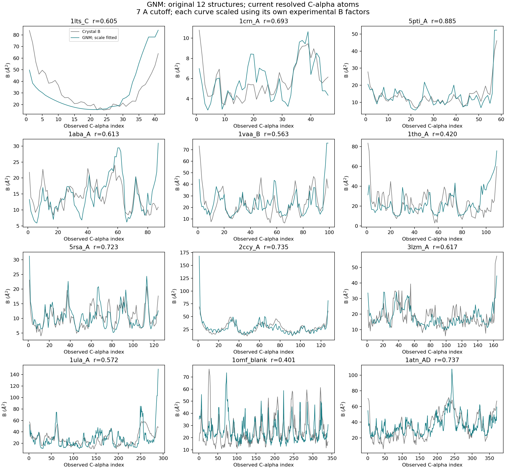
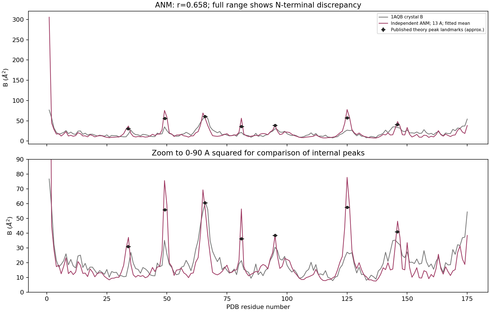

# GNM and ANM: independent reproduction and benchmark evidence

**Status: core numerical methods implemented and independently validated;
exact reproduction of all published numerical/biological results is incomplete.**
This is a learning and replication project. No new method, drug candidate,
binding-affinity result, or scientific novelty is claimed.

Two original papers are studied:

| Paper | Model | What it computes |
|---|---|---|
| Bahar, Atilgan & Erman (1997), *Direct evaluation of thermal fluctuations in proteins using a single-parameter harmonic potential*, Folding & Design 2:173-181. [DOI](https://doi.org/10.1016/S1359-0278(97)00024-2) | Gaussian Network Model (GNM) | Relative residue flexibility and correlated fluctuations from a C-alpha contact network |
| Atilgan et al. (2001), *Anisotropy of fluctuation dynamics of proteins with an elastic network model*, Biophysical Journal 80:505-515. [DOI](https://doi.org/10.1016/S0006-3495(01)76033-X) | Anisotropic Network Model (ANM) | Directional fluctuations and collective modes from a 3D elastic network |

These are foundational protein dynamics models that are small enough to
implement, derive, and audit on a CPU. They are not sequence-to-structure AI
models, and they do not reproduce the AlphaFold Evoformer. See
[the methodological review](docs/paper_review.md) for equations, assumptions,
original evaluation, and a study checklist.

## What actually ran

- Independent NumPy/SciPy implementations, with **8 passing scientific tests**.
- GNM on all **12 PDB entries** in the original paper at its **7 A cutoff**.
- ANM on the original **1AQB** structure at its stated **13 A cutoff**, with five
  additional diagnostic cutoffs kept separate from the primary result.
- **18/18 comparisons against ProDy 2.6.1 passed** when the eigenvalue-zero
  convention was matched. Maximum relative covariance discrepancy was
  approximately **7.74e-12**. This verifies the implementation, not agreement
  with every result in the papers.
- Actual input tables, SHA256 provenance, per-residue predictions, raw run
  logs, and numeric comparison tables are committed here.

| Evaluation on current resolved atoms | Result measured here | Published comparison status |
|---|---:|---|
| GNM: mean of 12 per-structure Pearson correlations with crystal B factors | 0.6304 | Original paper provides curves rather than a per-structure correlation table; the GNM normalization constants remain unreconciled |
| GNM: 5PTI Pearson correlation | 0.8853 | Measured here; not a number quoted from the paper |
| ANM: 1AQB Pearson correlation at 13 A | 0.6578 | Seven approximate published theoretical peak locations recovered within one residue; several amplitudes differ substantially |

All absolute B-factor curves are rescaled using the same structure's observed
B factors. This follows a calibration step in the papers and **does not establish
held-out prediction of absolute amplitudes**. Pearson correlation is invariant
to that global scale. No cutoff was selected to maximize the reported result.





## Re-run offline

Use Python 3.12. The selected C-alpha coordinate/B-factor tables are included;
neither a GPU nor a PDB download is required for these commands.

```bash
python -m venv .venv
source .venv/bin/activate
python -m pip install -r requirements-validation.txt
OPENBLAS_NUM_THREADS=1 python -m unittest discover -s tests -v
OPENBLAS_NUM_THREADS=1 python benchmark.py --validate-prody
```

The script exits nonzero if any independent implementation comparison fails.
Run it from this directory. It regenerates the numeric tables and figures.
To re-download and re-parse the original PDB files, optionally run:

```bash
python prepare_inputs.py
```

That command checks downloaded raw PDB SHA256 values against
[`data/provenance.json`](data/provenance.json) and fails if an upstream file has
changed. The bundled CA tables are the fixed inputs used for the committed run.
Raw PDBs are excluded from Git to keep the project small. Original paper PDFs
and private meeting notes are not redistributed.

## Inspect the evidence

- [Benchmark interpretation and unresolved differences](docs/benchmark_report.md)
- [GNM raw metrics and published normalization constants](results/gnm_benchmark.csv)
- [ANM primary and diagnostic cutoff metrics](results/anm_cutoff_diagnostics.csv)
- [Approximate ANM published-figure comparison](results/anm_published_figure5_landmarks.csv)
- [ProDy implementation comparisons](results/prody_validation.csv)
- [Residue count audit](results/data_audit.csv)
- [Test log](results/test_log.txt), [benchmark log](results/benchmark_log.txt), and [run manifest](results/run_manifest.json)
- [Slow-mode audit](results/anm_slow_mode_audit.json)

## Before proposing an improvement

Resolve the GNM scale convention and the ANM amplitude/mode discrepancies;
confirm the historical structure and preprocessing choices; then agree a fixed
baseline protocol and held-out evaluation with a mentor. A higher correlation at
a diagnostic cutoff does not by itself establish a contribution.

Implementation and documentation were prepared with AI assistance and the
recorded computations were executed. This repository does not certify that an
individual has independently mastered the derivations or that a mentor has
approved the project. The questions in the review are intended for that work.
