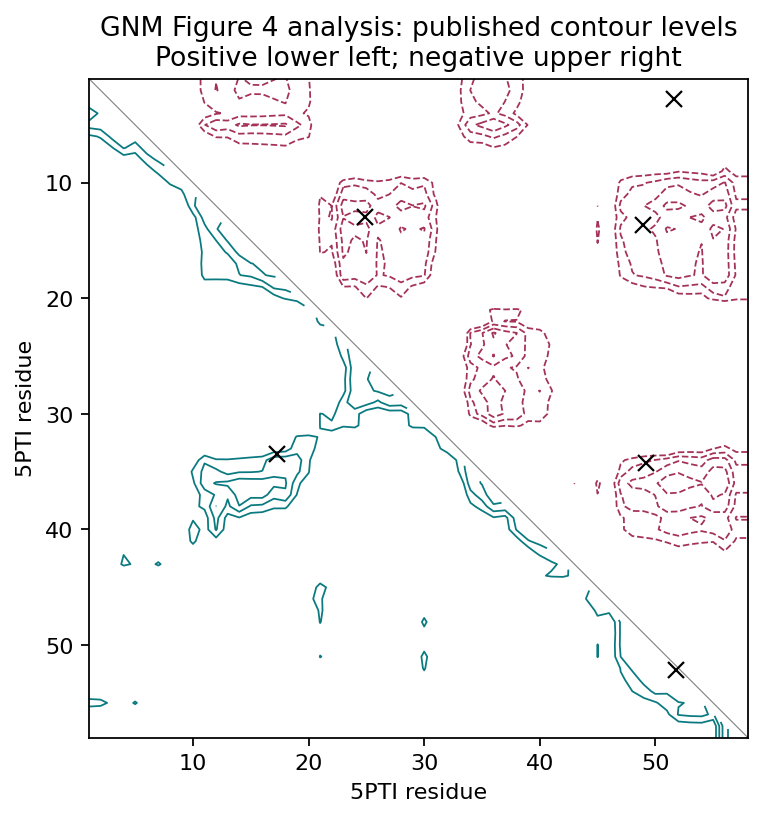
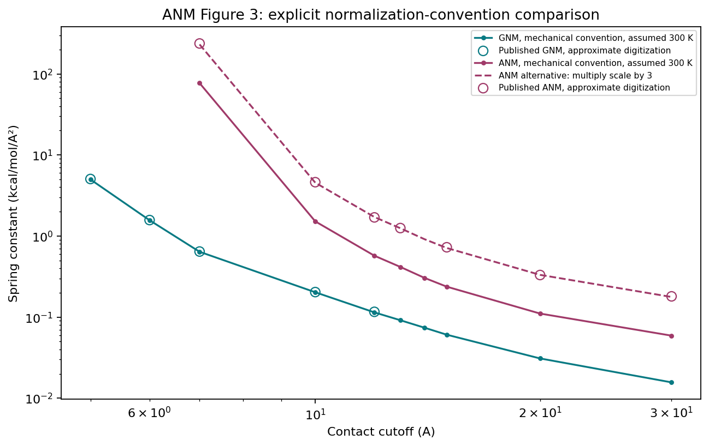

# GNM and ANM: reproduction and benchmark evidence

**All figure-related computational analyses are now implemented and executed.**
Exact agreement with every historical published result is **not established**:
remaining differences are measured in the [results ledger](docs/figure_coverage.md).
No new method or scientific novelty is claimed.

| Original paper | Model and output |
|---|---|
| Bahar, Atilgan & Erman (1997), *Direct evaluation of thermal fluctuations in proteins using a single-parameter harmonic potential*, Folding & Design 2:173–181. [DOI](https://doi.org/10.1016/S1359-0278(97)00024-2) | GNM: residue flexibility and correlations from a C-alpha contact graph |
| Atilgan et al. (2001), *Anisotropy of fluctuation dynamics of proteins with an elastic network model*, Biophysical Journal 80:505–515. [DOI](https://doi.org/10.1016/S0006-3495(01)76033-X) | ANM: directional fluctuations and collective modes from a 3D spring network |

See [equations, assumptions and original evaluation](docs/paper_review.md)
and the [benchmark interpretation](docs/benchmark_report.md).

## Executed results

- **13 scientific tests passed**, including analytic chain covariance, an
  independent equilibrium-operator Hessian, directional trace conservation,
  rigid-body invariance and finite-difference curvature.
- **18/18 ProDy 2.6.1 comparisons passed**; maximum relative covariance
  discrepancy is 7.74e-12 with matched eigenvalue thresholds.
- GNM: all **12 original structures**, prescribed **7 A cutoff**, B-factor
  profiles, 5PTI correlations, connectivity decomposition and boundary checks.
- ANM: **1AQB at 13 A**, cutoff/force-constant sweeps, complete spectra,
  principal-axis covariance, first 12 mode vectors, loops, ligand and displaced
  conformations. Experimental **1QAB** supplies Figure 10b's structural context.
- Fixed input tables, source hashes, covariance arrays, measurements, plots
  and execution logs are committed alongside the code.

| Published comparison | Outcome |
|---|---|
| GNM B-factor profiles on 12 structures | Mean per-structure experimental Pearson r = **0.6304**; not a published score |
| GNM Figure 4 correlation regions | Both marked positive regions and **3/4** marked negative regions fall inside the corresponding outer contours, consistent with the paper's qualitative result |
| ANM Figure 3, GNM spring constants | Five approximate published points agree within **1.6%**, assuming 300 K |
| ANM Figure 3, ANM spring constants | Seven points agree within **2.7%** under an explicit **threefold scale alternative**; standard mechanical scale differs by about a factor of three |
| ANM Figure 5, prescribed 13 A | Experimental Pearson r = **0.6578**; six vetted theory landmarks show residual amplitude differences |
| ANM Figure 10a, mode-2 residue-95/residue-65 amplitude ratio | **0.8207** here versus approximately **1.2794** in the figure; disagreement remains |

Spring-constant digitization uncertainty is about 4.65%. The 300 K temperature
is an explicit assumption. A convention-dependent match does not establish the
convention used by the authors. No parameters were optimized against those points.

Absolute B factors use each structure's observed B-factor sum to calibrate one
scale. This is **same-structure calibration**, not held-out amplitude prediction.
Diagnostic cutoffs do not replace the prescribed primary results.





## Re-run offline

Use Python 3.12. Included input tables make downloads and GPUs unnecessary.

```bash
python -m venv .venv
source .venv/bin/activate
python -m pip install -r requirements-validation.txt
OPENBLAS_NUM_THREADS=1 python -m unittest discover -s tests -v
OPENBLAS_NUM_THREADS=1 python benchmark.py --validate-prody
OPENBLAS_NUM_THREADS=1 python reproduce_figures.py
python verify_evidence.py
```

`benchmark.py` exits nonzero on an implementation mismatch.
`reproduce_figures.py` executes all additional analyses; runner completion does
not declare publication equivalence. `verify_evidence.py` checks source/input
hashes, expected outputs and recorded comparisons.

Optional source download and parsing audit:

```bash
python prepare_inputs.py
python prepare_supplementary.py
```

PDB hashes are checked against [provenance](data/provenance.json). Missing
residues are not filled in. Raw PDBs and article PDFs are not redistributed.
Parsed public coordinate tables support the offline workflow.

## Inspect the evidence

- [Every figure/table: result and remaining limits](docs/figure_coverage.md)
- [Original profiles](results/gnm_profiles.png) and [GNM parameter table](results/gnm_benchmark.csv)
- [Corrected ANM Figure 5 comparison](results/anm_published_comparison.png)
- [Connectivity and chain-boundary audit](results/extended/gnm_figures5_6_connectivity.png)
- [Spectra](results/extended/anm_figure4_spectra.png), [anisotropy](results/extended/anm_figure7_anisotropy.png) and [global mode](results/extended/anm_figure8_global_mode.png)
- [Structures/loops/retinol](results/extended/anm_structural_panels.png), [mode conformations](results/extended/anm_figure10a_conformations.png) and [experimental complex](results/extended/anm_figure10b_experimental_complex.png)
- [Full ANM covariance and first 12 modes](results/extended/1aqb_anm_covariance.npz)
- [ProDy checks](results/prody_validation.csv), [tests](results/test_log.txt), [main log](results/benchmark_log.txt) and [additional log](results/extended_log.txt)
- [Main manifest](results/run_manifest.json), [additional manifest](results/extended/run_manifest.json) and [evidence verification](results/evidence_verification.json)

Open historical questions concern the 1997 normalization constants, exact
original inputs, ANM amplitudes and second-mode displacement ratio. They require
original numerical outputs or additional method details. All discrepant results
are retained.
